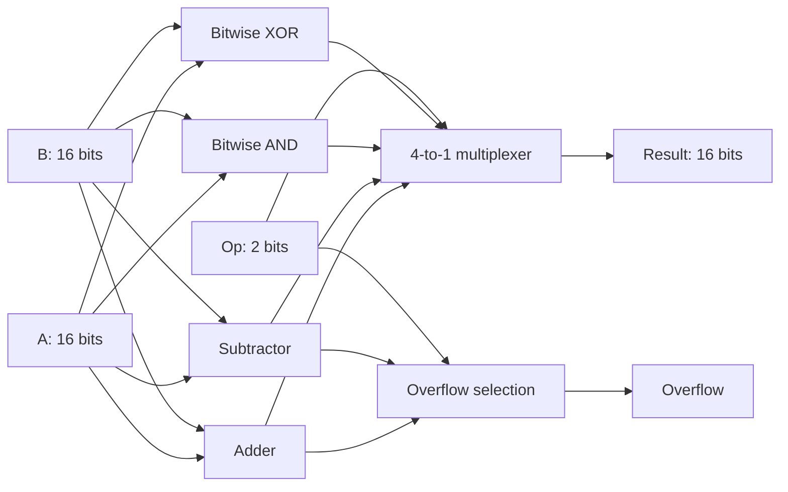

# 16-bit ALU in Verilog

A modular, combinational 16-bit arithmetic logic unit designed in Verilog and implemented using AMD Vivado. Four operation blocks compute in parallel; a 4-to-1 multiplexer selects the result. Signed arithmetic includes overflow detection.

## Operations

| `Op` | Operation | `Result` | `Overflow` |
| --- | --- | --- | --- |
| `00` | Addition | Low 16 bits of `A + B` | Signed addition overflow |
| `01` | Subtraction | Low 16 bits of `A - B` | Signed subtraction overflow |
| `10` | Bitwise AND | `A & B` | `0` |
| `11` | Bitwise XOR | `A ^ B` | `0` |

`A` and `B` are 16-bit two's-complement operands for arithmetic (-32768 to 32767). `Result` is a 16-bit bit vector; interpret it as signed when displaying arithmetic. Overflow indicates a signed result outside that range, not unsigned carry or borrow. Results wrap to 16 bits. There is no clock, reset, register, or pipeline.



## Repository layout

| Path | Contents |
| --- | --- |
| `rtl/` | Original six synthesizable Verilog modules |
| `tb/alu16_demo_tb.v` | Original five-case stimulus bench, module renamed for coexistence |
| `tb/alu16_tb.v` | Added self-checking bench with 4,256 checks |
| `scripts/` | Portable Vivado project, simulation, and synthesis Tcl scripts |
| `docs/reports/` | Selected original Vivado reports with host identity redacted |
| `.github/workflows/simulation.yml` | Icarus Verilog simulation on pushes and pull requests |

## Run simulation

With Icarus Verilog and its `vvp` runtime on your PATH, run from the repository root:

```sh
mkdir -p build
iverilog -g2012 -Wall -s alu16_tb -o build/alu16_tb.vvp rtl/*.v tb/alu16_tb.v
vvp build/alu16_tb.vvp
```

On Windows PowerShell, create the directory with `New-Item -ItemType Directory -Force build`, and replace `rtl/*.v` with `(Get-ChildItem rtl/*.v).FullName` if your executable does not expand wildcards.

Expected success message: `PASS: 4256 ALU checks`. The bench covers all four operations across 64 boundary/pattern pairs and 1,000 deterministic pseudorandom pairs. It checks both result and overflow, including positive and negative arithmetic overflow. A mismatch terminates with `$fatal`.

With Vivado on your PATH:

```sh
vivado -mode batch -source scripts/simulate.tcl
```

## Recreate the Vivado project

The supplied archive used **Vivado 2026.1** and part **`xa7a12tcpg238-2I`**, with no board selected. Use an installation with support for that part, or set the `FPGA_PART` environment variable to an installed target before running:

```sh
vivado -mode batch -source scripts/create_project.tcl
```

Open `build/vivado/alu16.xpr` in Vivado. The synthesis top is `alu16`; the simulation top is `alu16_tb`. Generated files remain under ignored `build/`. These scripts recreate that project and overwrite files there; keep source edits under `rtl/` and `tb/`.

To synthesize and generate a utilization report:

```sh
vivado -mode batch -source scripts/synthesize.tcl
```

## Original implementation results

The included reports are historical outputs from the supplied project, not new runs performed while preparing this repository.

| Metric | Original reported value |
| --- | --- |
| Slice LUTs | 49 / 8,000 (0.61%) |
| Slice registers | 0 |
| Occupied slices | 13 |
| Routable nets fully routed | 90 / 90 |
| Nets with routing errors | 0 |

The timing report states that there are **no user-specified timing constraints**. No validated maximum frequency or timing-closure claim is made. The DRC report lists `NSTD-1` and `UCIO-1`: all 51 logical I/O bits lack explicit I/O standards and pin locations. It also reports `CFGBVS-1` for missing configuration voltage properties. No XDC constraints or bitstream were supplied. Board deployment requires an appropriate wrapper/interface, board-specific pin and electrical constraints, configuration voltage settings, and timing requirements. Routing completion alone does not demonstrate operation on physical hardware.

## Validation status and scope

The original archive contains Vivado simulation artifacts and implementation reports. Its original bench supplies stimulus without automated assertions. Repository preparation adds a self-checking bench and CI configuration; neither that bench nor the new Vivado scripts was executed locally because Vivado and Icarus Verilog were unavailable. Run simulation before citing a passing verification result. CI results become available after publishing to GitHub.

The original RTL is preserved byte-for-byte. This is a 16-bit ALU, despite the input ZIP being named `ALU1.zip`. Parallelism here means concurrent operation blocks followed by selection; it does not imply pipelining, a processor, or a custom transistor-level implementation.

## Possible extensions

- Add zero, negative, and unsigned carry/borrow flags.
- Add a registered wrapper and constraints for a specific FPGA board.
- Extend formal or simulation coverage and capture waveform screenshots from a verified run.

## License

No license has been selected. The project owner should choose a license before granting reuse permissions. No third-party license or author identity has been assumed.
